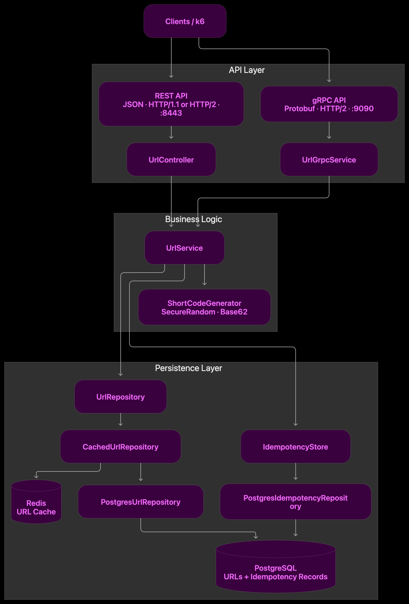
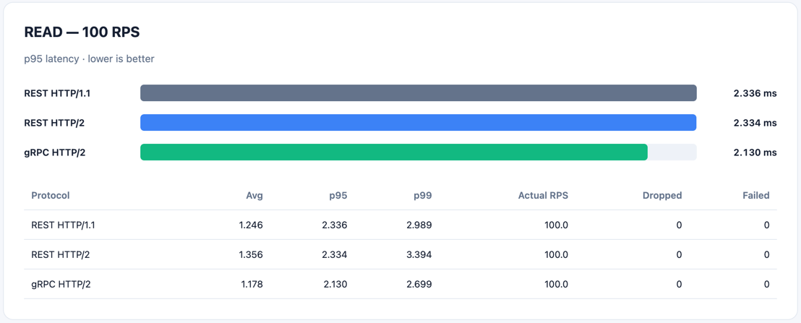
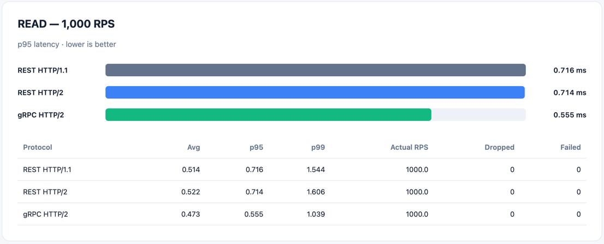
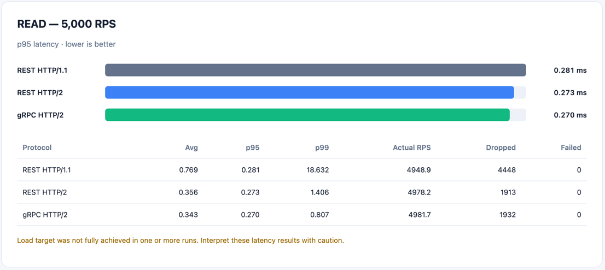
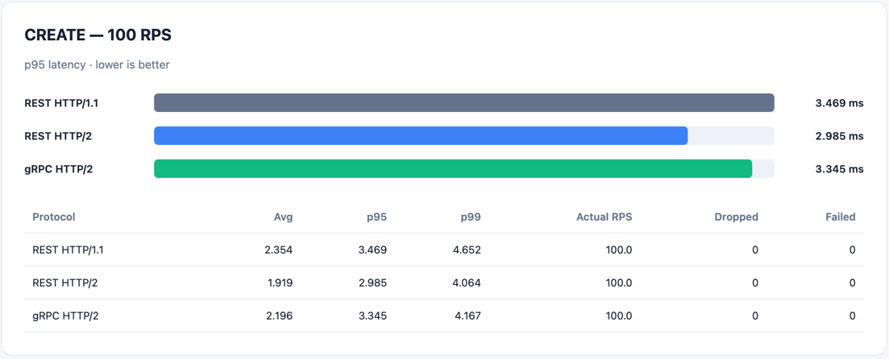
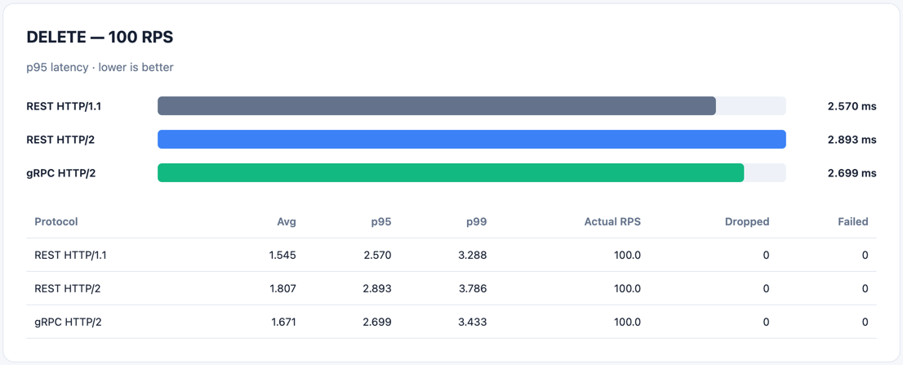

# URL Shortener - REST vs gRPC

A Java/Spring Boot URL shortening service developed for **SIS #2** to compare **REST/JSON over HTTP/1.1 and HTTP/2** with **gRPC/Protocol Buffers over HTTP/2**.

The project implements URL creation, resolution, and deletion using the same business logic and storage for both APIs. It also demonstrates idempotent writes, client-side timeouts and retries, and performance benchmarking with k6.

## Features

- **Two APIs:** REST/JSON and gRPC/Protobuf.
- **Three benchmark configurations:** REST HTTP/1.1, REST HTTP/2, and gRPC HTTP/2.
- **Storage:** in-memory repository for basic development, PostgreSQL for persistence, and optional Redis cache-aside for reads.
- **Short codes:** eight-character Base62 strings generated with `SecureRandom`; collisions are handled when saving.
- **TTL and soft deletion:** deleted or expired links cannot be resolved.
- **Idempotent creation:** repeated requests with the same owner, idempotency key, and payload return the original result; conflicting payloads are rejected.
- **Java clients:** per-attempt and overall deadlines, bounded exponential backoff with jitter, and selective retries.
- **Benchmarks:** k6 scenarios for READ, CREATE, and DELETE, with JSON summaries and CSV/Markdown comparison tables.

## Technology stack

| Component | Technology |
| --- | --- |
| Language | Java 21 |
| Framework | Spring Boot 4.1.1 |
| REST API | Spring Web MVC, JSON |
| RPC API | gRPC, Protocol Buffers |
| Persistent storage | PostgreSQL |
| Cache | Redis |
| Schema migrations | Flyway |
| Load testing | k6 |
| Build | Maven |

## Architecture


Both APIs call the same application service. Redis is an optional read cache; PostgreSQL remains the persistent source of truth. In-memory mode is available for local development.

## API

### REST

| Method | Endpoint | Success | Description |
| --- | --- | --- | --- |
| `POST` | `/api/v1/urls` | `201 Created` | Create a short URL |
| `GET` | `/api/v1/urls/{shortCode}` | `200 OK` | Resolve a short URL |
| `DELETE` | `/api/v1/urls/{shortCode}` | `204 No Content` | Soft-delete a short URL |

**Create request**

```http
POST /api/v1/urls
Content-Type: application/json
Idempotency-Key: example-request-001
```

```json
{
  "originalUrl": "https://example.com/articles/123",
  "ttlHours": 24
}
```

**Create response (example)**

```json
{
  "shortCode": "aB3xY9Q2",
  "originalUrl": "https://example.com/articles/123",
  "expiresAt": "2026-11-01T12:00:00Z"
}
```

**Resolve response**

```json
{
  "originalUrl": "https://example.com/articles/123"
}
```

A missing, expired, or deleted short code returns `404`. Reusing an idempotency key with different creation parameters produces `409 Conflict`.

### gRPC

The service contract is defined in `src/main/proto/url_shortener.proto`.

| RPC | Request | Response |
| --- | --- | --- |
| `CreateUrl` | `original_url`, `ttl_hours`, `idempotency_key` | `short_code`, `original_url`, `expires_at` |
| `ResolveUrl` | `short_code` | `original_url` |
| `DeleteUrl` | `short_code` | Empty response |

gRPC carries the idempotency key inside the Protobuf request, whereas REST uses an HTTP header.

## Running locally

### Prerequisites

- JDK 21 or newer
- Maven wrapper (included)
- PostgreSQL and Redis for the persistent/cached profiles
- k6 for benchmarks
- Node.js for benchmark data generation and result summaries

No Docker setup is required.

### Profiles

| Profiles | Purpose |
| --- | --- |
| Default / `memory` | In-memory development |
| `postgres` | PostgreSQL storage |
| `postgres,redis` | PostgreSQL with Redis caching |

## Reliability

### Idempotency

Creation is identified by the owner and `Idempotency-Key`.

- **Same key + same parameters:** return the original short URL.
- **Same key + different parameters:** reject the request as a conflict.
- **Different keys:** create independently.

Idempotency records are persisted with the PostgreSQL profile so concurrent requests can be deduplicated. The same key is retained across client retries.

### Timeouts and retries

The Java REST and gRPC clients use a shared retry policy:

| Setting | Value |
| --- | --- |
| Maximum attempts | 3 |
| Per-attempt deadline | 2 seconds |
| Overall deadline | 5 seconds |
| Backoff | Exponential with jitter |
| REST retry conditions | I/O failures; HTTP 502, 503, 504 |
| gRPC retry conditions | `UNAVAILABLE`, `DEADLINE_EXCEEDED` |

.png)

## Performance benchmarks

The final measurements compare these three configurations with **PostgreSQL + Redis**:

1. REST/JSON over HTTP/1.1
2. REST/JSON over HTTP/2
3. gRPC/Protobuf over HTTP/2

The same k6 scenarios and URL datasets are used for each protocol

### Measured READ latency

Latency values in milliseconds, reported as **medians of per-run statistics** across three runs.

| Protocol | Target RPS | Avg | p95 | p99 | Dropped iterations |
| --- | ---: | ---: | ---: | ---: | ---: |
| REST HTTP/1.1 | 100 | 1.246 | 2.336 | 2.989 | 0 |
| REST HTTP/2 | 100 | 1.356 | 2.334 | 3.394 | 0 |
| gRPC HTTP/2 | 100 | 1.178 | 2.130 | 2.699 | 0 |
| REST HTTP/1.1 | 1,000 | 0.514 | 0.716 | 1.544 | 0 |
| REST HTTP/2 | 1,000 | 0.522 | 0.714 | 1.606 | 0 |
| gRPC HTTP/2 | 1,000 | 0.473 | 0.555 | 1.039 | 0 |
| REST HTTP/1.1 | 5,000 | 0.769 | 0.281 | 18.632 | 4,448 |
| REST HTTP/2 | 5,000 | 0.356 | 0.273 | 1.406 | 1,913 |
| gRPC HTTP/2 | 5,000 | 0.343 | 0.270 | 0.807 | 1,932 |





### Measured CREATE and DELETE latency

All runs used 100 target RPS, three repetitions, with **zero failed checks and zero dropped iterations**.

| Operation | Protocol | Avg (ms) | p95 (ms) | p99 (ms) |
| --- | --- | ---: | ---: | ---: |
| CREATE | REST HTTP/1.1 | 2.354 | 3.469 | 4.652 |
| CREATE | REST HTTP/2 | 1.919 | 2.985 | 4.064 |
| CREATE | gRPC HTTP/2 | 2.196 | 3.345 | 4.167 |
| DELETE | REST HTTP/1.1 | 1.545 | 2.570 | 3.288 |
| DELETE | REST HTTP/2 | 1.807 | 2.893 | 3.786 |
| DELETE | gRPC HTTP/2 | 1.671 | 2.699 | 3.433 |





### Serialized payload sizes

Measured application **message bodies only**, in bytes:

| Operation | REST/JSON | gRPC/Protobuf |
| --- | ---: | ---: |
| CREATE request | 106 | 121 |
| CREATE response | 157 | 115 |
| READ request body | 0 | 10 |
| READ response | 92 | 76 |
| DELETE request body | 0 | 10 |
| DELETE response | 0 | 0 |
